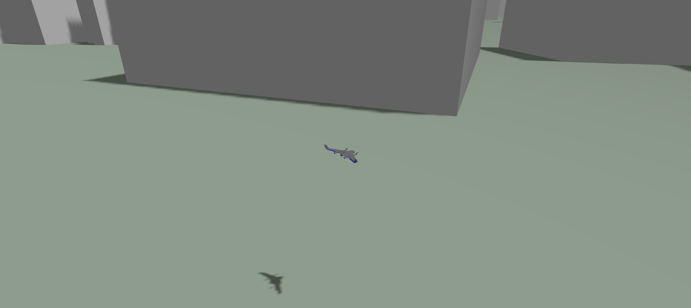
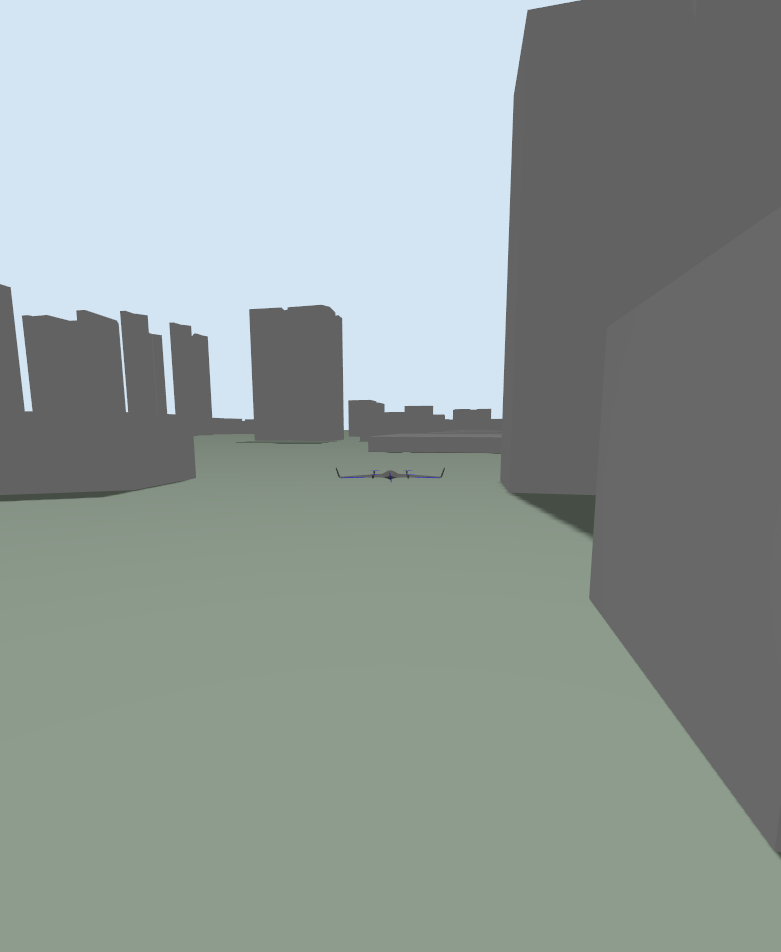

# 캠퍼스 환경에서 VTOL 방향키 조종

공식 [PX4 Standard VTOL](https://github.com/PX4/PX4-gazebo-models/tree/main/models/standard_vtol)을 캠퍼스 환경에 추가했다. 날개·승강용 로터 4개·전진용 프로펠러가 있는 기체다. 이번 조종 구성은 **수직 이착륙·호버링 모드**이며 Gazebo의 로터 추력 기반 속도 제어기를 사용한다.

## 실행

Ubuntu 22.04 터미널에서:

```bash
cd /mnt/c/Users/choih/Desktop/개인_대회/we_meet
bash Gazebo/run_vtol.sh
```

PowerShell에서:

```powershell
wsl -d Ubuntu-22.04 -- bash /mnt/c/Users/choih/Desktop/개인_대회/we_meet/Gazebo/run_vtol.sh
```

Gazebo와 **VTOL Keyboard Controller** 창이 함께 열린다. 시뮬레이션은 자동으로 재생되고 기체는 **8m 목표 고도까지 이륙**한다. 카메라는 **기체 뒤 8m, 좌우 오프셋 0m, 위 1m**에서 기수를 따라 회전하는 후면 시점이다. 시작 위치는 벽과 날개가 겹치지 않는 캠퍼스 좌표 `(-110, -90, 0.6)m`로 조정했다.

이미 같은 VTOL 조종 세션이 실행 중이면 새로 켜지 않고 기존 창을 사용한다. 다시 시작하려면 기존 조종 창을 닫은 후 명령을 실행한다. 다른 도형·캠퍼스 미리보기와 분리한 `inha_songdo_vtol` partition을 사용한다.

## 키 입력

**VTOL Keyboard Controller 창을 클릭해 포커스를 둔 상태에서 조종한다.** Gazebo 창을 클릭하면 수평 명령을 멈추고 카메라를 조작할 수 있다. 다시 기체를 조종하려면 조종 창을 클릭한다.

| 키 | 동작 |
|---|---|
| ↑ | 기체 앞쪽으로 이동 |
| ↓ | 기체 뒤쪽으로 이동 |
| ← | 기체 왼쪽으로 이동 |
| → | 기체 오른쪽으로 이동 |
| Shift + ↑ | 목표 고도 올리기 |
| Shift + ↓ | 목표 고도 내리기 |
| Shift + ← | 기수 왼쪽 회전 |
| Shift + → | 기수 오른쪽 회전 |
| Space | 이동을 멈추고 현재 고도 유지 |
| Esc | 조종 창과 이 세션의 Gazebo 종료 |

이동 방향은 기체 기준이다. 기수를 돌린 뒤 ↑를 누르면 바뀐 기수 방향으로 이동한다. 대각선 입력의 총속도는 단일 방향 속도와 같게 정규화한다. 기본 수평 속도는 **4m/s**, 슬라이더로 1~10m/s를 지정할 수 있다.

키를 떼면 해당 이동 명령은 0으로 돌아가며, 기체는 물리 제어기의 감속을 거쳐 호버링한다. 키 입력 해제·창 최소화·UI 입력 heartbeat 만료도 처리한다. 조종 창에서 포커스를 잃으면 수평 입력이 해제된다. 키를 떼는 순간 기체 위치가 즉시 고정되는 방식은 아니다.

## 조종 창 버튼

- **Take off (8m):** 지상에서 다시 이륙하거나 8m 이상의 현재 고도를 유지한다.
- **Hold / Space:** 현재 고도를 목표로 잡고 이동 입력을 지운다.
- **Land:** 천천히 하강하고 지면 가까이에서 승강용 모터 제어를 끈다.
- **Rear camera:** 카메라를 기체 중심선 뒤쪽 시점으로 되돌린다. 기체가 회전해도 좌우로 비틀린 추적 오프셋을 두지 않는다.

조종 창을 닫으면 실행기가 자신이 시작한 Gazebo 프로세스 그룹도 종료한다. 다른 캠퍼스 미리보기나 다른 Gazebo 세션은 종료하지 않는다. 터미널의 Ctrl+C로도 종료할 수 있다.

## 구현 구조

```text
조종 창의 방향키·Shift 입력
    ↓ Gazebo Transport Twist, 30Hz
/keyboard_vtol/cmd_vel
    ↓
Gazebo MulticopterVelocityControl
    ↓ 로터별 회전속도 / Actuators component
승강용 MulticopterMotorModel 4개
    ↓ 추력·토크
Gazebo 물리 엔진의 기체 운동
    ↓ 30Hz 시뮬레이션 ground-truth odometry
고도 유지용 외부 루프·상태 표시
```

기체 pose를 연속 덮어써서 이동시키지 않는다. 원본의 질량·관성·날개 lift/drag·조종면 형상을 활용하고 실제 로터 추력으로 비행한다. 고도 유지 루프는 위치 센서의 실측값이 아닌 Gazebo ground truth를 사용한다.

PX4 SITL·MAVLink·QGroundControl·고정익 전환은 이 키보드 조종 경로에 포함되지 않는다. 전진용 프로펠러는 수동 회전 관절로 남겨 두고 모터 플러그인을 제외했다. 전진 이동도 승강 로터의 자세 제어로 수행한다. 실제 PX4 VTOL 전환·임무 비행이 필요하면 보존한 원본 `standard_vtol`과 별도의 PX4 제어 경로를 사용해야 한다.

**건물과 지면의 충돌은 활성화돼 있다.** 건물 형상에 맞춘 1,529개 볼록 조각으로 벽·옥상을 채웠다. 기체 충돌 상자도 원본의 얇은 날개 범위에서 기수·동체를 포함하는 보수적 `1.10×2.20×0.34m` 범위로 보완했다. 건물에 부딪히면 물리 반응에 따라 기체가 기울거나 떨어질 수 있으며, 자동 장애물 회피·충돌 손상 모델은 아니다.

## 파일과 출처

| 파일 | 역할 |
|---|---|
| `run_vtol.sh` | Ubuntu에서 한 번에 시작하는 진입점 |
| `tools/run_keyboard_vtol.py` | Gazebo·조종 창 실행, 중복 실행 방지, 종료 정리 |
| `tools/vtol_keyboard.py` | Tk 키 입력·Gazebo 통신·고도 유지·카메라 추적 |
| `tools/build_keyboard_vtol.py` | 원본 VTOL에서 로컬 호버링 모델·월드 생성 |
| `models/keyboard_vtol/model.sdf` | 로컬 VTOL 모델·로터 제어기·odometry |
| `models/keyboard_vtol/ADAPTATION.json` | 원본 대비 수정 내역 |
| `worlds/inha_songdo_vtol.sdf` | 기존 캠퍼스 + VTOL + 기체를 보기 위한 초기 시점 |
| `vendor/px4-gazebo-models/` | 원본 모델·메시·BSD-3-Clause 라이선스 보존 |
| `vendor/px4-gazebo-models/SOURCE.json` | 고정 commit·파일별 SHA256 |
| `logs/vtol_latest.log` | 가장 최근 실제 GUI 실행 로그 |
| `validation/vtol_acceptance.json` | 물리 비행 시험 결과 |
| `validation/vtol_keyboard_check.json` | 실제 Tk 이벤트 시험 결과 |
| `validation/vtol_scene.png` | 실제 Gazebo 3D 화면 캡처 |
| `validation/vtol_rear.png`, `rear_camera_check.json` | 후면 시점 화면과 실제 카메라 위치 검증 |
| `validation/building_collision_acceptance.json` | 옥상·빈 지면·VTOL 벽 접촉 검증 |

원본 repository: `https://github.com/PX4/PX4-gazebo-models`.

고정 commit: `e5997f455e33ec071c7c677fc59a65781de496a4`.

원본 모델은 수정하지 않고 별도의 `keyboard_vtol` 파생 모델을 만들었다. 메시의 `model://standard_vtol/...` 참조는 vendor 모델 검색 경로로 해석된다. BSD-3-Clause 원문은 vendor의 `LICENSE`에 있다.

## 의존성과 재생성

현재 WSL에는 필요한 `gz.transport13`, `gz.msgs10`과 `python3-tk`를 확인·준비했다. 다른 PC에서는 Gazebo Harmonic 설치와 다음 패키지가 필요하다.

```bash
sudo apt install python3-tk python3-gz-transport13 python3-gz-msgs10
```

실행기는 `/usr/bin/python3`를 사용한다. 별도 pip·ROS 환경은 필요 없다.

원본 자산을 새로 받거나 파생 파일을 재생성할 때 프로젝트 루트에서 실행한다.

```bash
python3 Gazebo/tools/fetch_vtol_assets.py
python3 Gazebo/tools/build_keyboard_vtol.py
```

다운로드 manifest가 있으면 기록된 commit을 사용한다. `build_qgis_scene.py`로 캠퍼스 월드를 다시 생성한 경우에도 `build_keyboard_vtol.py`를 다시 실행하면 해당 캠퍼스 구성이 VTOL 월드에 반영된다. Gazebo를 종료한 뒤 재생성하고 다시 실행한다.

## 실제 확인 결과

2026-11-09, Ubuntu 22.04 WSL2 / Gazebo 8.15.0에서 시험했다. 아래 수치는 이 로컬 시뮬레이터 시험 결과이며 실기체 성능이 아니다.

| 시험 | 결과 |
|---|---|
| 5m 자동 이륙 시험 | 약 4.996m 도달 |
| 2초 호버링 수평 이동 | 약 0.041m |
| 전진/후진 명령 2.5초 | +3.557 / -3.753m |
| 좌/우 이동 명령 2.5초 | +3.739 / -3.729m |
| 양방향 yaw 명령 2.5초 | +0.702 / -0.680rad |
| 상승 명령 후 고도 변화 | 약 +3.147m |
| 입력 heartbeat 만료 | 수평 명령 0으로 복귀 |
| 착륙 판정 고도 | 약 0.164m |
| 실제 Tk 방향키 이벤트 | 전진 명령과 실제 기체 이동 확인 |
| KeyRelease / 창 최소화 | 입력·수평 명령 해제 확인 |
| Shift+↑ 이벤트 | 목표 고도 증가 확인 |
| 실제 GUI 세션 | 8m 도달, 모델 3개 등록, 추적 서비스·장면 캡처 확인 |
| 건물 벽 접근 | 기체 중심이 벽 앞 약 0.575m까지 접근, 관통하지 않음 |
| 옥상/빈 공간 낙하 | 구체가 옥상에는 받쳐지고, 건물 밖에서는 지면까지 낙하 |
| 자동 후면 카메라 | 기체 좌표계 평균 오프셋 약 `(-7.9998, 0.000005, 1.0000)m` |

반복 실행하는 검증 명령:

```bash
python3 Gazebo/tools/test_vtol_flight.py
python3 Gazebo/tools/test_vtol_keyboard.py
python3 Gazebo/tools/test_building_collisions.py
# VTOL GUI를 실행해 둔 상태에서 후면 카메라 위치 확인
python3 Gazebo/tools/check_rear_camera.py
```

첫 시험은 별도 partition의 headless 물리 시뮬레이션이며, 두 번째는 짧은 Tk 시험 창을 열고 자동 키 이벤트를 보낸다. 실행 중인 사용자 VTOL 세션과는 다른 partition을 사용한다. 결과는 `logs/`에 저장된다.





참고: [Gazebo MulticopterVelocityControl 공식 설명](https://gazebosim.org/api/sim/8/classgz_1_1sim_1_1systems_1_1MulticopterVelocityControl.html), [PX4 Standard VTOL 모델](https://github.com/PX4/PX4-gazebo-models/tree/e5997f455e33ec071c7c677fc59a65781de496a4/models/standard_vtol).
