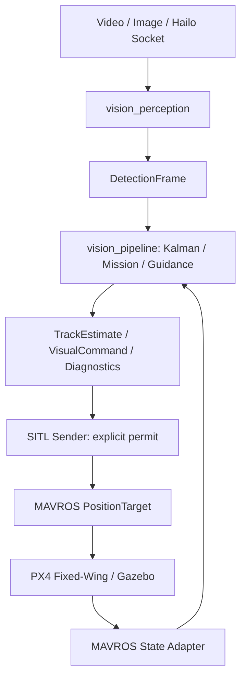

# INHA ALATUS v0.4 아키텍처

기본 동작은 분석 전용이다. 이 산출물은 Level 1 소스 기반이며, ROS/Humble와 비행 물리 런타임 검증은 별도다. v0.3 소스를 읽은 뒤 확장했고 원본을 regression/v03에 보존했다. ROS 의존성이 없는 추정·제어 수학과 ROS/MAVROS I/O를 분리했다.

## 패키지와 데이터 흐름

| 패키지 | 역할 | 변경 |
|---|---|---|
| alatus_interfaces | 기존 메시지 6종 + v0.4 메시지 5종 | 기존 정의 바이트 보존, 추가 정의 |
| alatus_runtime | v0.3 Mock/진단 및 Mission/ClockGuard/Socket 계약 | 기존 순수 로직 그대로 재사용 |
| alatus_bringup | v0.3 및 v0.4 실행 모드 | 6종 Launch 추가, observer 기본을 MAVROS 경로로 교체 |
| alatus_vision | Perception + 추정/Mission/Guidance | 새 Python 패키지, ROS 노드 2개 |
| alatus_mavros | 상태 변환 + 별도 SITL 송신 | 새 Python 패키지, 송신기는 Closed-loop Launch만 |
| legacy_alatus_px4_status | DDS VehicleStatus 어댑터 | COLCON_IGNORE, 기본 의존성 없음 |

Mock Shadow는 Perception과 Pipeline의 두 노드만 실행한다. Mock State는 Pipeline이 명시적으로 생성한다. 실상태 모드에는 State Adapter만 추가한다. 모든 기본 SafetyStatus.control_allowed는 false다. 별도 /alatus/sitl_authority만 송신기 권한을 나타낸다.

## 실행 모드

| 모드 | Launch | 상태/입력 | 명령 송신 |
|---|---|---|---|
| A | mock_shadow.launch.py | Mock/Mock | 없음 |
| B | video_shadow.launch.py | 명시적 Mock 상태/실제 영상 | 없음 |
| C | sitl_shadow.launch.py | MAVROS/Mock Detection | 없음 |
| C-Vision | vision_sitl_shadow.launch.py | MAVROS/ROS Image YOLO | 없음 |
| D | sitl_closed_loop.launch.py | MAVROS/ROS Image | 검토 Permit + enable 서비스가 필요 |
| E | onboard_shadow.launch.py | MAVROS/실제 Hailo 결과 Socket | 없음 |
| F | 제공하지 않음 | 후속 실기체 제어 검토 | 금지 |

SITL/Hailo/영상은 여기서 실행하지 않았다. 파일이 없으면 모델 로딩을 실패시키거나 입력 없이 Invalid로 유지한다. 실제 모델 자동 다운로드나 가짜 HEF 성공 경로는 없다.

## 알고리즘 경계

Detection은 현재 프레임에서 객체를 찾는다. Kalman은 관측의 시계열 상태와 불확실성을 추정한다. MIL은 영상 패치의 외형을 추적하는 별개 방법으로, 본 구현의 의존성이 아니다. 영상 속도는 기체 회전과 투영의 영향을 포함하므로 표적의 실제 이동속도가 아니다.

Camera Optical -> Body FLU -> World ENU 회전을 거친 LOS를 실제 Ground Course와 비교한다. PD는 Course Error에서 제한된 Course Rate를 만들고 Lookahead 위치를 계산한다. 수직 PD 출력은 Flight Path Angle이며 Lookahead 고도 오프셋으로 변환한다. 최종 송신은 위치뿐이다. Bank는 운동학적 진단값이며 PX4에 직접 송신하지 않는다. PX4가 NPFG/TECS와 자세/각속도 제어를 수행한다.

이 방식은 실험용 Bearing Follow다. 횡풍에서 Ground Course와 Heading을 구분하지만, 바람 추정·Net Plane Interception·Terminal Capture는 완성하지 않았다. Lookahead와 Horizon이 실제 선회능력에 맞는지 SITL에서 검증해야 한다.

## 원본 분석 근거

core.py Tracker는 hits, freshness, target ID 연속성을 검사하며 Kalman 행렬이 없다. GuidanceProposal은 dimensionless image diagnostic이었다. Safety Gate는 설정으로 해제할 수 없는 false를 반환한다. PX4 어댑터는 VehicleStatus만 수신하며 위치/속도/대기속도는 제공하지 않는다. PerceptionSocket은 엄격한 JSON schema/sequence/동일 호스트 capture time을 검사한다. Docker의 Observer는 읽기 전용 입력 경계다. 이 특성을 보존하고 새로운 물리적 계약을 추가했다.

구버전 문서는 docs/legacy_v03에 있으며 v0.4 실행 명령에는 사용하지 않는다. v0.3의 Launch name 중복 지정만으로 노드가 반드시 두 번 생기는 것은 아니다. 당시 현상은 현재 자료로 원인을 실증할 수 없으며 이번 신규 Launch에는 불필요한 name remap을 넣지 않았다.
