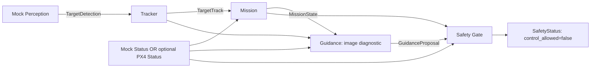

> 이 파일은 v0.1/v0.2 설계 이력입니다. 현재 v0.3 실행·파라미터·PX4 SHA 설정은 IMPLEMENTED_PARAMETERS_V03_KO.md와 RPI_DOCKER_WALKTHROUGH_KO.md가 우선합니다.

# 데이터 계약과 실행 구조

모든 custom 메시지는 `alatus_interfaces/msg`에 있습니다.

| Topic | Type | Publisher → Subscriber | 주기 |
|---|---|---|---|
| /alatus/detection | TargetDetection | mock_perception → tracker | 10 Hz |
| /alatus/target_track | TargetTrack | tracker → mission/guidance | 10 Hz, 첫 관측 이후 |
| /alatus/aircraft_status | AircraftStatus | mock_status 또는 px4_status → mission/guidance/safety_gate | mock 10 Hz / PX4 수신 시 |
| /alatus/mission_state | MissionState | mission → guidance/safety_gate | 10 Hz |
| /alatus/guidance_proposal | GuidanceProposal | guidance → safety_gate | 10 Hz |
| /alatus/safety_status | SafetyStatus | safety_gate → 관찰자 | 10 Hz |

서비스 `/alatus/shadow_mission`은 `std_srvs/srv/SetBool`: true로 분석 시작, false로 중단 및 ABORT reset.
서비스 응답 성공은 기체/비행 허가를 뜻하지 않습니다. Action은 장시간 목표 실행이 없어 아직 필요하지 않습니다.

내부 QoS는 reliable / volatile / keep-last depth 10입니다. latched 과거 상태를 재사용하지 않습니다.
PX4 구독은 sensor_data QoS(best effort / volatile / depth 5)를 사용합니다.
[ROS 2 Humble 공식 QoS 문서 원문](https://raw.githubusercontent.com/ros2/ros2_documentation/humble/source/Concepts/Intermediate/About-Quality-of-Service-Settings.rst)

## 단위·시간·유효성

* `camera_optical` 영상: x는 왼쪽 0→오른쪽 1, y는 위 0→아래 1. 너비/높이 정규화 좌표입니다.
* confidence [0,1], 최소 0.7; x/y 유한수 [0,1]; 동일 target ID, 증가하는 관측 시간, 0.5초 이내 3회로 track 확인.
* 이 tracker는 단일 ID 확인기입니다. YOLO, 데이터 연관, 칼만 필터, occlusion 예측은 구현하지 않습니다.
* `header.stamp`는 공통 ROS clock. freshness는 `0 <= now-stamp <= 0.5초`; 미래·역행·오래된 입력은 거절합니다.
* TargetTrack은 원 관측 timestamp를 보존합니다. timer 발행이 관측을 새롭게 만들지 않습니다.
* Guidance는 생성 시각과 observation_stamp를 별도로 보존; safety에서 양쪽 freshness 검사.
* px4_timestamp_us는 수신한 PX4 timestamp의 microseconds 값을 그대로 보관합니다. DDS time offset이 적용될 수 있으므로 무조건 boot time이라고 해석하지 않습니다. header는 ROS 수신 시각이라 transport 지연을 검출하지 못합니다.
* AircraftStatus.status_received는 최근 telemetry 존재만 의미합니다. 속도·위치·자세·estimator·RC 상태를 보장하지 않습니다.
* flight_ready_known/manual_override_known는 기본 및 현재 어댑터에서 false. unknown을 안전함으로 해석하지 마십시오.
* `image_error_x=x−0.5`, `image_error_y=y−0.5`, `correction_norm=clip(−0.5*image_error_x,−0.2,+0.2)`.
  모두 무차원 학습값입니다. 이 부호나 gain은 비행역학·조종면·roll command를 정의하지 않습니다.
* SafetyStatus.inputs_valid는 shadow pipeline 입력 검사 결과. 비행 가능 판정이 아닙니다. control_allowed는 항상 false.

## 상태 전이

| 현재 | 조건 | 다음 |
|---|---|---|
| IDLE | 시작 요청 없음 | IDLE |
| IDLE/SEARCH | 시작 요청, 상태 수신 정상, track 미확인 | SEARCH |
| IDLE/SEARCH/TRACK_SHADOW | 시작 요청, 상태/track 정상 | TRACK_SHADOW |
| 시작 요청 상태 | status 중단/failsafe | ABORT |
| TRACK_SHADOW | track 무효/중단 | ABORT |
| ABORT | 입력 회복 또는 true 재요청 | ABORT |
| 모든 상태 | false 요청 | IDLE |

ABORT는 비행 중단 명령이 아닙니다. PX4와 아무 제어 연결이 없습니다.
현재 상수 timeout/gain은 core.py에 명시되어 있습니다. 3인이 계약 변경 전 함께 검토하십시오.
sim clock이 멈추면 ROS timer/freshness도 멈출 수 있습니다. 실제 안전감시는 독립 monotonic watchdog이 필요하며 여기에는 없습니다.
